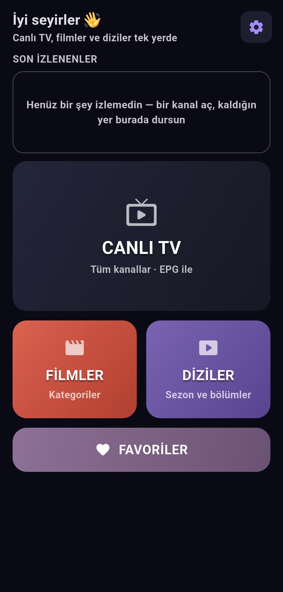

# HStream

Android ve Android TV için IPTV oynatıcısı. Xtream Codes, M3U bağlantısı veya yerel M3U listesi ile canlı yayın, film ve dizi izlenir. Telefon, tablet ve kumandalı televizyon aynı arayüzü paylaşır.

A modern IPTV player for Android and Android TV. Watch live TV, movies, and series from Xtream Codes, an M3U URL, or a local M3U file.

- Mimari ve geliştirme notları: [DEVELOPMENT.md](DEVELOPMENT.md)
- İndirme sayfası: [docs/index.html](docs/index.html) — sürüm, APK bağlantısı ve yayın notlarını GitHub Releases'ten kendi çeker
- Sürüm sürüm değişiklikler: [CHANGELOG.md](CHANGELOG.md)

GitHub Pages ile yayınlamak için: depo → Settings → Pages → Source: `main` / `/docs`.

## İçindekiler

- [Türkçe](#türkçe)
- [English](#english)
- [Ekran görüntüsü](#ekran-görüntüsü)

## Türkçe

### Özellikler

- Canlı TV, filmler, diziler ve favoriler — tek hub
- Üç kaynak türü: Xtream, M3U bağlantısı, yerel M3U
- Oynatıcı: bölüm şeridi, bölüm sonu kartı, kumanda, ekran girintisi, tam ekran
- Kaldığın yerden devam: film ve bölümler bıraktığın saniyeden açılır
- Son İzlenenler karuselinde tür etiketi (Canlı / Film / Dizi / Bölüm N) ve kalınan dakika rozeti
- Resim içinde resim: canlı yayınlar dahil; film ve dizilerde küçük pencereden 10 sn geri/ileri
- Oynatıcı içi hızlı ayarlar: hız (0.5x–3x), altyazı boyutu, uyku zamanlayıcısı, tampon süresi
- Beş dil: Türkçe, English, Español, Deutsch, Français
- Hakkında ekranı: sürüm, lisans (AGPL-3.0), kaynak kodu ve güncelleme denetimi
- Uygulama içi güncelleme: yeni sürüm çıkınca haber verir, sürüm notlarını gösterir ve indirmeye yönlendirir; güncellemeden sonra "Yenilikler" özeti
- Ayarlar: NSFW gizleme, Son İzlenenler
- Xtream kaynaklarında kullanıcı adı ve bitiş tarihi

### Derleme

HStream, Fred TV kaynak ağacının üzerine bir overlay uygular. Overlay `hstream/files` içindedir.

#### Windows (taşınabilir ortam)

`app` klasörünün bulunduğu kökte:

```bat
hstream\build.bat
```

Açılan menüde **[2]** (derle), bitince **[4]** (çıkış). APK: `output\HStream.apk`

İlk kurulumda aynı kökte `setup.bat` → **[1]** ile araçlar ve Fred TV kaynağı iner.

#### Linux / macOS

İlk kurulum (araçlar `tools/` altına iner, sisteme kurulmaz):

```bash
chmod +x setup.sh hstream/build.sh
./setup.sh
```

Menüde **[1]**. Sonraki derlemeler:

```bash
./hstream/build.sh
```

Flutter ve Rust zaten sistemdeyse Fred TV kaynağını `app/` olarak klonlayıp doğrudan `hstream/build.sh` yeter. `HSTREAM_APP` ile kaynak yolunu değiştirebilirsiniz.

#### Elle derleme

Gerekenler: Flutter, Android NDK, Rust, [cargo-ndk](https://github.com/bbqsrc/cargo-ndk).

```bash
git clone --depth 1 https://github.com/Fredolx/fred-tv-mobile.git app
cp -R hstream/files/flutter/. app/flutter/
cp hstream/files/rust/src/sql.rs app/src/sql.rs
cp hstream/files/rust/src/lib.rs app/src/lib.rs
cp hstream/files/rust/src/m3u.rs app/src/m3u.rs
cp hstream/files/rust/src/xtream.rs app/src/xtream.rs
cp hstream/files/rust/src/tls.rs app/src/tls.rs
cp hstream/files/rust/Cargo.toml app/Cargo.toml

# TLS arka ucunu rustls'e cevir (setup.bat'in yaptigi yamayla ayni).
# Android'de native-tls-vendored OpenSSL derlemesi ister; rustls istemez.
sed -i 's/native-tls-vendored/rustls/' app/Cargo.toml

cd app
cargo ndk -t arm64-v8a -t armeabi-v7a -t x86_64 --platform 24 \
  -o flutter/android/app/src/main/jniLibs build --release

cd flutter
flutter pub get
flutter build apk --release
```

APK: `app/flutter/build/app/outputs/flutter-apk/app-release.apk`

Play Store dışından yüklenen APK'larda Play Protect uyarısı görülebilir.

### İmzalama (bir kez yapılır)

Sideload edilen bir APK'da yeni sürümün eskisinin üstüne kurulabilmesi için sabit bir imzalama anahtarı gerekir. Android, aynı paket adındaki bir güncellemeyi yalnızca imzası aynıysa kabul eder. Anahtar yoksa derleme debug anahtarıyla imzalanır; o anahtar makineye bağlıdır ve süresi dolduğunda kullanıcılar güncellemeyi kuramaz.

**Anahtarı ilk dağıtımdan önce oluştur.** Hâlihazırda debug anahtarıyla imzalanmış bir APK dağıtıldıysa, anahtar oluşturduktan sonra o kullanıcılar yeni sürümü üstüne kuramaz; silip yeniden kurmaları gerekir (ayarları, kaynakları ve geçmişleri gider).

#### Adım adım

1. Anahtarı oluştur

```bat
hstream\keystore.bat
```

Linux / macOS:

```bash
chmod +x hstream/keystore.sh
./hstream/keystore.sh
```

2. Parola gir. Boş bırakırsan araç güçlü bir parola üretip ekrana yazar. Kendi parolanı gireceksen yalnızca harf, rakam, nokta, tire ve alt çizgi kullan (komut satırında `& ! < > | %` gibi karakterler sorun çıkarır).

3. Parolayı ve `keys/` klasörünü hemen yedekle. Araç `keys\OKUBENI.txt` içine talimatı da yazar. En az iki ayrı yerde dursun: bir parola yöneticisinde parola, özel (paylaşıma kapalı) bir bulut klasöründe veya USB bellekte klasörün kendisi.

4. Doğrula. `keys\key.properties` oluşmuş olmalı ve içinde `storeFile=` satırı `keys\hstream-release.jks` dosyasını göstermeli.

5. Derle. Bir sonraki derleme anahtarı kendiliğinden kullanır:

```bat
hstream\build.bat
```

`keys/` dizini `.gitignore` içindedir; depoya veya GitHub'a asla yüklenmez. `build.bat` / `build.sh` anahtarı derlemeden önce otomatik bağlar.

Anahtarı veya parolasını kaybedersen mevcut kurulumlar bir daha güncellenemez; geri dönüşü yoktur.

#### Derleme hata verirse

- `Keystore file '...' not found for signing config 'release'` — `keys/key.properties` içindeki `storeFile` yolu bozulmuş demektir. Dosya bir Java `.properties` dosyasıdır ve orada `\` kaçış karakteridir; Windows yolu tek ters bölü ile yazılırsa yol okunurken kırpılır. `build.gradle` yolu kendisi onarır ve gerekirse `keys/hstream-release.jks` konumuna düşer, yani güncel sürümde bu hata kendiliğinden çözülür. Eski bir dosyayı elle düzeltmek istersen `storeFile` satırını düz bölü ile yaz: `storeFile=C:/.../keys/hstream-release.jks`
- `keys/key.properties` yok — `keys/` klasörünü (parolayla birlikte) yedekten geri koy ya da "İmzalama" bölümündeki 1. adımdan yeni anahtar üret.
- `Signer #1 certificate DN: ... CN=Android Debug` — derleme debug anahtarıyla imzalanmış; `key.properties` bağlanmamış. Adım 1'e dön.

### Sürüm yükseltme

Sürüm numarası tek bir dosyada tutulur:

```
hstream/files/flutter/pubspec.yaml
```

```yaml
version: 1.0.0+1
#        ^^^^^ ^ build numarası (versionCode) — her yayında ARTAR
#        ^ sürüm adı (versionName) — kullanıcıya görünür
```

- Sürüm adı (`1.0.0`) → kullanıcının gördüğü sürüm.
- Build numarası (`+1`) → Android'in `versionCode`'u. Her yayında en az 1 artmalı, aksi halde Android güncellemeyi "daha eski" sayıp reddeder.

`hstream/build.bat` overlay'i `app/` üzerine kopyaladığı için başka dosyayı elle düzenlemek gerekmez.

### Yayınlama

1. Sürümü yükselt — `hstream/files/flutter/pubspec.yaml` içindeki `version:` satırını artır (örn. `1.0.1+2`). Build numarası her yayında artmalı.

2. Sürüm notunu yaz — [CHANGELOG.md](CHANGELOG.md) en üste yeni bir `## <sürüm>` bölümü ekle; sonra aynı maddelerin kısa hâlini `hstream/files/flutter/lib/hstream_surum_notlari.dart` içine de ekle. (CHANGELOG kullanıcıya giden tam metin; uygulama içi özet kısa maddelerdir.)

3. Anahtar var mı bak — `keys\key.properties` yoksa "İmzalama" bölümündeki 1. adıma dön.

4. Derle — `hstream\build.bat` → menüde **[2]**, sonra **[4]**. Çıktı: `output\HStream.apk`

5. İmzayı doğrula — çıktı debug anahtarıyla imzalanmışsa anahtar bağlanmamış demektir. Araçlar `tools\` altındaysa:

```bat
set "JAVA_HOME=%CD%\tools\jdk"
tools\android-sdk\build-tools\35.0.0\apksigner.bat verify --print-certs -v output\HStream.apk
```

(`build-tools` klasör adı sürüme göre değişir.) `Signer #1 certificate DN` satırında `CN=Android Debug` görmemelisin; `CN=HStream` görmelisin.

6. Kur ve dene — APK'yı telefona/televizyona kurup oynatıcıyı, PiP'i ve Son İzlenenler'i bir kez dene. Emin olmadan dağıtma.

7. GitHub'da yayınla — uygulama içi güncelleme denetimi bu yayından beslenir, bu yüzden üç şey şart:

   - Etiket (tag) sürümle aynı olmalı: `v1.0.1` ya da `1.0.1` (baştaki `v` sorun değil). Etiket sürümden farklı olursa uygulama güncellemeyi görmez.
   - Açıklama (release body) = sürüm notu. Uygulamadaki "Yeni sürüm var" penceresi bu metni gösterir; boş bırakılırsa "not girilmemiş" yazar. CHANGELOG'daki ilgili bölümü buraya yapıştır.
   - APK'yı ek (asset) olarak yükle. Varsa uygulamadaki "İndir" düğmesi doğrudan APK'yı indirir; yoksa yayın sayfası açılır.

   Web sitesi/topluluk dağıtımı için aynı APK'yı `HStream-1.0.1.apk` gibi sürüm adıyla paylaşmak indirenlerin ayırt etmesini kolaylaştırır.

   İndirme sayfası (`docs/index.html`) sürümü, APK bağlantısını ve yayın notunu GitHub'dan kendi çeker; sayfada elle güncellenecek bir şey yoktur.

### Lisans

GNU Affero General Public License v3.0 (AGPL-3.0) — tam metin: [LICENSE](LICENSE)

HStream, Fred TV kaynak ağacı üzerine uygulanan bir overlay olarak derlenir ve onunla tek bir eser oluşturur. Fred TV AGPL-3.0 ile lisanslandığı için HStream'in tamamı da AGPL-3.0 altındadır; bu bir tercih değil, lisansın şartıdır.

Bunun pratikteki anlamı, yayınlarken:

- APK'yı dağıtırken kaynak kodun tamamı erişilebilir olmalı. Kaynak deposu herkese açıksa bu şart sağlanır; APK'yı yalnızca dosya olarak dağıtıp kaynağı vermemek lisansa aykırıdır.
- Fred TV'nin telif ve lisans bildirimleri korunur (`app/LICENSE` ve kaynak dosyalardaki başlıklar silinmez).
- HStream'de değiştirdiğin dosyalar da aynı lisansla paylaşılır.
- Uygulamayı bir sunucu üzerinden (web arayüzü, uzak oynatıcı) sunacaksan AGPL §13 ayrıca kaynağa erişim bağlantısı vermeni ister.

Ayrıntı için `LICENSE` dosyasına bak.

## English

### Features

- Live TV, movies, series, and favorites — single hub
- Three source types: Xtream, M3U URL, local M3U
- Player: episode strip, next-episode card, D-pad, display cutout, fullscreen
- Resume where you left off: movies and episodes open at the last position
- Continue watching carousel with a type label (Live / Movie / Series / Episode N) and a resume-time badge
- Picture-in-picture: live channels included; 10-second back/forward from the small window for movies and series
- In-player quick settings: speed (0.5x–3x), subtitle size, sleep timer, buffer length
- Five languages: Turkish, English, Spanish, German, French
- About screen: version, license (AGPL-3.0), source code and an update check
- In-app updates: tells you when a new version is out, shows the release notes and takes you to the download; a "What's new" summary after updating
- Settings: hide NSFW, continue watching
- Xtream sources show username and expiry date

### Build

HStream is an overlay on Fred TV. Files live in `hstream/files`.

#### Windows (portable toolchain)

From the directory that contains `app`:

```bat
hstream\build.bat
```

In the menu choose **[2]** (build), then **[4]** (quit). APK: `output\HStream.apk`

First-time setup: `setup.bat` → **[1]**.

#### Linux / macOS

First-time setup (toolchain under `tools/`, nothing system-wide):

```bash
chmod +x setup.sh hstream/build.sh
./setup.sh
```

Choose **[1]**. Later builds:

```bash
./hstream/build.sh
```

If Flutter and Rust are already installed, clone Fred TV at `app/` and run `hstream/build.sh` directly. Override the checkout path with `HSTREAM_APP`.

#### Manual build

Requires Flutter, Android NDK, Rust, and cargo-ndk. Same commands as in the Turkish section above.

Sideloaded APKs may trigger a Play Protect warning.

### Signing (do this once)

Sideloaded APKs need a stable signing key so a new version can install over the old one. Android only accepts an update of the same package name when it carries the same signature. Without a key, release builds use the debug key, which is machine-specific and expires — after that, users cannot install updates.

Create the key before your first public release. If an APK signed with the debug key has already been handed out, those users cannot install the next version on top of it; they must uninstall and reinstall, losing settings, sources and history.

#### Step by step

1. Create the key

```bat
hstream\keystore.bat
```

Linux / macOS:

```bash
chmod +x hstream/keystore.sh
./hstream/keystore.sh
```

2. Enter a password. Leave it empty and the tool generates a strong one and prints it. If you type your own, stick to letters, digits, dots, dashes and underscores (`& ! < > | %` break the command line).

3. Back up the password and the `keys/` folder right away. The tool also writes `keys\OKUBENI.txt` with the same instructions. Keep at least two copies in separate places: the password in a password manager, the folder in a private (not shared) cloud folder or on a USB stick.

4. Verify. `keys\key.properties` should exist and its `storeFile=` line should point at `keys\hstream-release.jks`.

5. Build. The next build picks the key up automatically:

```bat
hstream\build.bat
```

`keys/` is git-ignored and must never be committed or uploaded. `build.bat` / `build.sh` attach the key before building.

If you lose the key or its password, existing installs can never be updated again. There is no way back.

#### If the build fails

- `Keystore file '...' not found for signing config 'release'` — the `storeFile` value in `keys/key.properties` got mangled. The file is a Java `.properties` file, where `\` is an escape character; a Windows path written with single backslashes loses them when read. `build.gradle` repairs the path itself and falls back to `keys/hstream-release.jks`, so current versions recover on their own. To fix an old file by hand, write the `storeFile` line with forward slashes: `storeFile=C:/.../keys/hstream-release.jks`
- `keys/key.properties` missing — restore the `keys/` folder (with the password) from your backup, or create a new key from step 1 under "Signing".
- `Signer #1 certificate DN: ... CN=Android Debug` — the build used the debug key, so `key.properties` was not attached. Go back to step 1.

### Versioning

The version lives in one file:

```
hstream/files/flutter/pubspec.yaml
```

```yaml
version: 1.0.0+1
#        ^^^^^ ^ build number (versionCode) — increases with EVERY release
#        ^ version name (versionName) — what the user sees
```

- Version name (`1.0.0`) → the release the user sees.
- Build number (`+1`) → Android's `versionCode`. It must increase by at least 1 for every release, otherwise Android treats the update as older and refuses it.

`hstream/build.bat` copies the overlay onto `app/`, so no other file needs to be edited by hand.

### Releasing

1. Bump the version — edit the `version:` line in `hstream/files/flutter/pubspec.yaml` (e.g. `1.0.1+2`). The build number must increase with every release.

2. Write the release note — add a new `## <version>` section at the top of [CHANGELOG.md](CHANGELOG.md), then add a short version of the same bullets to `hstream/files/flutter/lib/hstream_surum_notlari.dart`. (The changelog is the full text users see on the release page; the in-app list is a short summary.)

3. Check the key — if `keys\key.properties` is missing, go back to step 1 under "Signing".

4. Build — `hstream\build.bat` → **[2]**, then **[4]**. Output: `output\HStream.apk`

5. Verify the signature — if the output is signed with the debug key, the key was not attached. With the bundled tools:

```bat
set "JAVA_HOME=%CD%\tools\jdk"
tools\android-sdk\build-tools\35.0.0\apksigner.bat verify --print-certs -v output\HStream.apk
```

(The `build-tools` folder name depends on the version.) `Signer #1 certificate DN` must not say `CN=Android Debug`; it must say `CN=HStream`.

6. Install and test — put the APK on a phone and a TV, and try the player, PiP and Continue watching once. Do not ship untested.

7. Publish on GitHub — the in-app update check reads this release, so three things matter:

   - The tag must match the version: `v1.0.1` or `1.0.1` (a leading `v` is fine). A mismatched tag means the app will not see the update.
   - The release body is the release note. The in-app "New version available" dialog shows this text; leave it empty and the app says "no notes for this version". Paste the matching CHANGELOG section here.
   - Attach the APK as an asset. When present, the in-app "Download" button fetches the APK directly; otherwise it opens the release page.

   For website/community distribution, naming the file `HStream-1.0.1.apk` helps people tell builds apart.

   The download page (`docs/index.html`) reads the version, the APK link and the release note from GitHub by itself — there is nothing to update by hand.

### Credits

HStream is based on Fred TV. Portions of the interface and later features were written with AI assistance.

### License

GNU Affero General Public License v3.0 (AGPL-3.0) — full text in [LICENSE](LICENSE)

HStream is built as an overlay on the Fred TV source tree and forms a single work with it. Because Fred TV is licensed under AGPL-3.0, all of HStream is AGPL-3.0 as well — this is a requirement of the license, not a choice.

In practice, when you publish:

- Distributing the APK requires the complete source code to be available. A public repository satisfies this; handing out the APK alone does not.
- Fred TV's copyright and license notices must be kept (`app/LICENSE` and the headers in source files must not be removed).
- Files you changed in HStream are shared under the same license.
- If you ever serve the app over a network (web UI, remote player), AGPL §13 additionally requires you to offer a link to the source.

## Ekran görüntüsü


